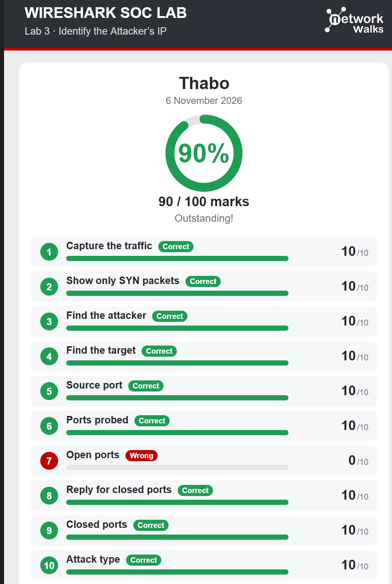
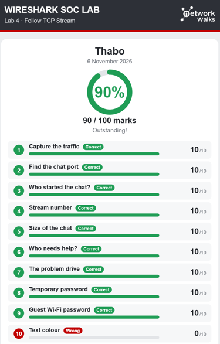
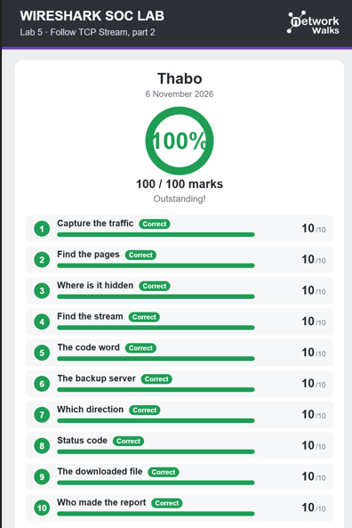
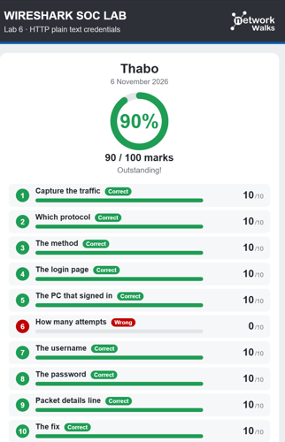
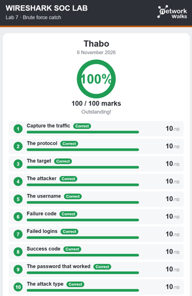
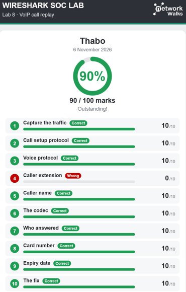
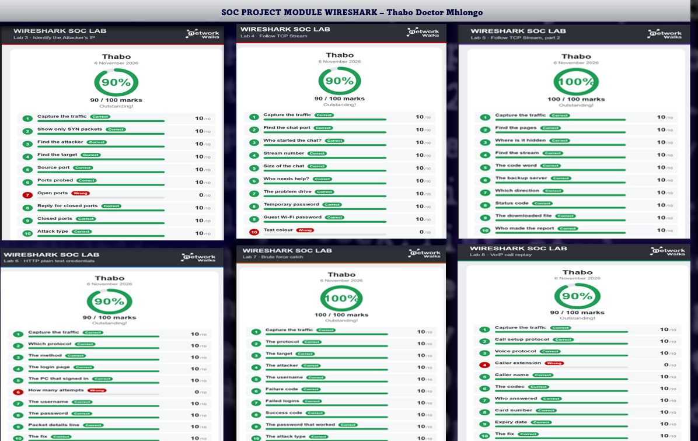

## Overview

This project document a practical SOC investigation using Wireshark to capture and analyze network traffic.
The objective is to identify unusual network behaviour, investigate suspicious connections and detect 
potential malicious activity.

## Investigation Evidence Results

## Wireshark SOC LAB 3

## Identify the Attackers IP.
I have managed to track and find the IP address of the attacker and the opened/closed Ports that were 
tested by the intruder. I also manage to learn more about the port scan investigation using wireshark.

What I learned is that attackers often scan multiple ports on a target system to identify open
ports and potential vulnerabilities. If the same IP address appears repeatedly while
attempting to communicate through multiple ports, it may indicate suspicious activity or a
possible port-scanning attack. 

Attackers commonly use TCP to establish connections and probe target systems for accessible
services. Monitoring repeated connection attempts, source IP addresses and TCP traffic
patterns can help identify potential reconnaissance activities during network traffic analysis.

## Wireshark SOC LAB 4

## Follow TCP Stream Part 1

I learned that conversations and data transmitted over HTTP are not encrypted,
which means sensitive information such as usernames, passwords and private messages 
can potentially be intercepted and exposed by attackers.
This highlights the importance of using HTTPS with TLS encryption to protect data in transit
ensuring that communication between users and web servers remains confidential and secure.

## Wireshark SOC Lab 5

## Follow TCP Stream Part 2

In this lab, I managed to identify hidden information embedded within a file. 
I learned that information can be concealed in HTML files using comments
such as "<!-- Hidden -->". 
which are not displayed on the webpage but can still be viewed by inspecting the HTML 
source code. This demonstrates how hidden information can be discovered through basic file 
and source code analysis.

## Wireshark SOC LAB 6

## HTTP plain text credentials

HTTPS uses TLS encryption to protect data transmitted between users and web servers, 
ensuring that sensitive information cannot easily be read if network traffic is 
captured using tools such as Wireshark. 

Instead of exposing credentials in plain text, the encrypted traffic appears unreadable to
anyone attempting to intercept it without the appropriate decryption keys. 
This helps maintain data confidentiality and protect users against credential theft 
and unauthorised access.

## Wireshark SOC LAB 7

## Brute Force Catch

## Wireshark SOC LAB 8

## VOIP Call replay

I analysed VoIP network traffic using Wireshark and identified the protocols responsible for
establishing and carrying a phone call. I discovered that Session Initiation Protocol was used
to initiate the call while Real-time Transport Protocol carried the voice data through
multiple small packets transmitted approximately every 60 milliseconds.
By inspecting the SIP INVITE message I have identified extension number 101 as the caller.

Voice conversations can potentially be intercepted and replayed when voice packets are
transmitted without encryption. This creates a confidentiality risk because attackers
monitoring network traffic may be able to capture and listen to private conversations.

## Key findings:

Call setup protocol : SIP.
Voice transmission protocol : RTP.
Calling extension : 101.

Security risk: Unencrypted voice packets can potentially be captured and replayed.

## Recommended Solution

The company should implement Secure Real-time Transport Protocol (SRTP) to encrypt voice 
packets and protect conversations from interception. SIP signalling should be protected using
TLS to secure call setup messages. These security measures help maintain the confidentiality
and integrity of VoIP communications and reduce the risk of unauthorised access to private
conversations.

VoIP communication can expose sensitive conversations when encryption is not implemented.
Using SRTP for voice traffic and TLS for SIP signalling is essential for securing business
phone communications and protecting confidential information.

## Overall results and summary

## <h2><u>This is the summarized report of the results for my LAB Projects</u></h2>

LAB 3 = Identify the Attacker's IP        : 90/100 – Outstanding

LAB 4 = Follow TCP Stream Part 1          : 90/100 – Outstanding

LAB 5 = Follow TCP Stream Part 2          : 100/100 – Outstanding

LAB 6 = HTTP Plain Text Credentials       : 90/100 – Outstanding

LAB 7 = Brute Force Catch                 : 100/100 – Outstanding

LAB 8 = VoIP Call Replay                  : 90/100 – Outstanding

## AVERAGE SCORE: 93.33/100 – OUTSTANDING

